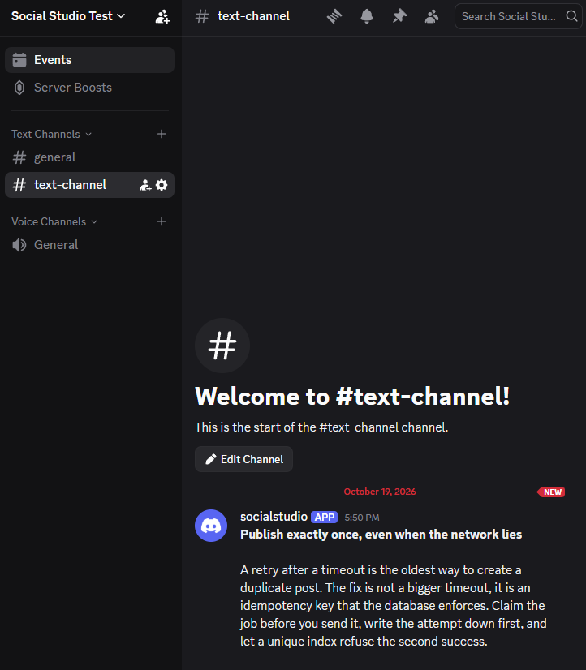
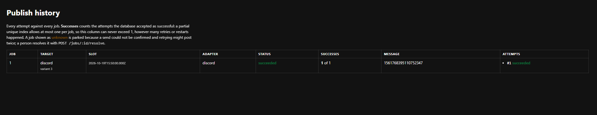

# Evidence

One proof per requirement from the brief. Transcripts below are real output, pasted verbatim from the
command shown directly above them. Any redacted or reconstructed summaries are explicitly identified as
such; output is not presented as a verbatim transcript unless it is one.

Where a requirement is not built yet, the row says so rather than being left blank.

**Setup used for every transcript on this page**

```bash
npm install
cp .env.example .env     # then set DISCORD_WEBHOOK_URL, or point PUBLISHER_DISCORD at a mock
npm start                # API on http://localhost:3000
```

Transcripts were captured on Node 24.14.0, Windows 11, against a fresh (deleted) `./data/studio.db`.
`PUBLISHER_DISCORD=mock_x` was set for these runs, since ingestion does not touch an adapter.

## Requirement status

| # | Requirement | Status | Proof |
|---|---|---|---|
| 1 | Ingestion via URL or Markdown, stored; generation reads only the stored post | **Done** | [E1](#e1-ingestion-via-url-or-markdown) |
| 2 | Constraint profiles enforced by code; a bad variant is blocked | **Done** | [E2](#e2-constraint-profiles-are-enforced-by-code) |
| 3 | Review workflow; unapproved schedule returns 4xx + message | **Done** | [E3](#e3-review-workflow), [E5a](#e5a-probe-3-an-unapproved-variant-cannot-be-scheduled) |
| 4 | Adapter layer: one interface, one real target, >= 2 mocks; swap = config only | **Done** | [E4](#e4-adapter-layer) |
| 5 | Idempotent publish: same variant + slot never posts twice, even under retries | **Done** | [E5b](#e5b-the-same-variant-and-slot-yields-exactly-one-job), [E6b](#e6b-probe-5a-the-crash-proved-by-a-re-runnable-test) |
| 6 | Durable scheduling: worker restart mid-batch, zero duplicates | **Done** | [E6b](#e6b-probe-5a-the-crash-proved-by-a-re-runnable-test), [E6c](#e6c-probe-5b-the-same-thing-by-killing-a-real-process) |
| 7 | Publish history: every attempt recorded and visible, with its result | **Done** | [E7](#e7-publish-history) |
| 8 | Secrets clean: tokens in `.env` only; `.env.example` present | **Done** | [E8](#e8-secrets-are-clean) |
| 9 | README: what it does, architecture, exact run steps, one command + a seed step | **Done** | [E9](#e9-a-stranger-can-run-it) |

## E1: Ingestion via URL or Markdown

**Requirement.** A blog post is accepted as a URL or as pasted Markdown and stored. The stored post is the
single source of truth for generation.

### E1a: pasted Markdown

The title is taken from the `# ` heading, and tags are normalised (the `#` prefix dropped, lowercased,
duplicates and whitespace-only entries removed), so hashtag counts stay countable per platform later.

```bash
curl -s -X POST localhost:3000/posts -H 'content-type: application/json' \
  -d '{"markdown":"# Why idempotency matters\n\nA retry after a timeout must not create a second post. This article explains the claim-then-send pattern, and why a unique key per variant and slot is the cheapest correct answer.","tags":["#Idempotency","backend","  backend "]}'
```

```json
{"id":1,"sourceType":"markdown","sourceUrl":null,"title":"Why idempotency matters","bodyMd":"# Why idempotency matters\n\nA retry after a timeout must not create a second post. This article explains the claim-then-send pattern, and why a unique key per variant and slot is the cheapest correct answer.","tags":["idempotency","backend"],"createdAt":"2026-10-19T12:20:23.214Z"}
```

Three tags were sent (`"#Idempotency"`, `"backend"`, `"  backend "`) and two were stored
(`["idempotency","backend"]`).

### E1b: a real URL

The page is fetched **once**, here, at ingest. The title and body text are extracted from the HTML.

```bash
curl -s -X POST localhost:3000/posts -H 'content-type: application/json' \
  -d '{"url":"https://example.com/"}'
```

```json
{"id":2,"sourceType":"url","sourceUrl":"https://example.com/","title":"Example Domain","bodyMd":"This domain is for use in documentation examples without needing permission. This is not a service; avoid relying on it for testing and monitoring purposes.","tags":[],"createdAt":"2026-10-19T12:20:23.418Z"}
```

### E1c: the stored post is what generation will read

Reading the post back returns the stored row, with no second fetch of the remote page. Generation
(phase 2) takes `bodyMd` from this row, so a variant cannot change later because the source blog changed.

```bash
curl -s localhost:3000/posts/2
```

```json
{"id":2,"sourceType":"url","sourceUrl":"https://example.com/","title":"Example Domain","bodyMd":"This domain is for use in documentation examples without needing permission. This is not a service; avoid relying on it for testing and monitoring purposes.","tags":[],"createdAt":"2026-10-19T12:20:23.418Z"}
```

### E1d: bad input is refused with a reason that names the problem

Each line is the request body, then the HTTP status and response body.

```bash
curl -s -o /tmp/r -w '%{http_code} ' -X POST localhost:3000/posts \
  -H 'content-type: application/json' -d "$body"   # run once per body below
```

```text
{"url":"https://example.com","markdown":"# hi\n\nlong enough body text goes here"}
  -> 400 {"error":"bad_request","message":"Send either \"url\" or \"markdown\", not both"}
{}
  -> 400 {"error":"bad_request","message":"Send either \"url\" (a blog post address) or \"markdown\" (the post text)"}
{"markdown":"# hi"}
  -> 400 {"error":"bad_request","message":"\"markdown\" has too little readable text to generate from (minimum 20 characters)"}
{"url":"http://169.254.169.254/latest/meta-data/"}
  -> 400 {"error":"bad_request","message":"\"url\" points at a local or private address (169.254.169.254), which is not fetched"}
{"url":"file:///C:/Windows/win.ini"}
  -> 400 {"error":"bad_request","message":"\"url\" must use http or https, got \"file:\""}
{"url":"https://httpbin.org/image/png"}
  -> 422 {"error":"fetch_failed","message":"https://httpbin.org/image/png is \"image/png\", not a readable text page"}
```

```bash
curl -s -w ' [%{http_code}]\n' localhost:3000/posts/999
curl -s -w ' [%{http_code}]\n' localhost:3000/posts/abc
```

```text
{"error":"not_found","message":"No post with id 999"} [404]
{"error":"bad_request","message":"\"post id\" must be a positive integer, got \"abc\""} [400]
```

The third and fourth lines are not in the brief. `169.254.169.254` is the cloud metadata address: because
`POST /posts {url}` makes the server fetch an address the caller chose, loopback, private and link-local
addresses are refused ([src/posts/fetchUrl.ts](src/posts/fetchUrl.ts)). That guard matches on hostname and
does not resolve DNS, so a hostname resolving to a private IP would still pass. Stated here rather than
claimed as complete.

## E2: constraint profiles are enforced by code

**Requirement.** Each platform has rules (max length, tone, hashtag count) and code enforces them. A
rule-breaking variant never reaches review, and the error names the broken rule.

This section proves the profiles and the validator. The "never reaches review" half is proved once the
variant endpoints exist, in the next step.

### E2a: the active profiles, as the running app reports them

The rules are data in [src/platforms/profiles.ts](src/platforms/profiles.ts), and the endpoint reads that
same data, so this output cannot drift from what the validator enforces.

```bash
curl -s localhost:3000/platforms
```

Formatted for reading (the raw response is JSON):

```text
x         adapter=mock_x        len=1-280  tags<=2  mentions<=3  links<=1  "!"<=1  shoutLen=4  banned=[lol,omg,wtf,smh,yolo]
linkedin  adapter=mock_linkedin len=100-3000  tags<=5  mentions<=5  links<=2  "!"<=2  shoutLen=4  banned=[lol,omg,wtf,smh,yolo]
discord   adapter=mock_x        len=1-2000  tags<=0  mentions<=0  links<=3  "!"<=3  shoutLen=0  banned=[]
```

`shoutLen=4` means an ALL-CAPS word of 4 or more characters is refused. `shoutLen=0` disables that rule,
which is why Discord tolerates shouting.

### E2a2: probe 1, one post becomes one valid variant per platform

The post was ingested as Markdown ([E1a](#e1a-pasted-markdown) shows that step), then:

```bash
curl -s -X POST localhost:3000/posts/1/generate
curl -s localhost:3000/posts/1/variants
```

```text
--- Discord (message)  id=10  323/2000 chars  status=draft ---
**Publish exactly once, even when the network lies**

A retry after a timeout is the oldest way to create a duplicate post. The fix is not a bigger timeout, it is an idempotency key that the database enforces. Claim the job before you send it, write the attempt down first, and let a unique index refuse the second success.

--- LinkedIn (long form)  id=9  444/3000 chars  status=draft ---
Publish exactly once, even when the network lies

A retry after a timeout is the oldest way to create a duplicate post. The fix is not a bigger timeout, it is an idempotency key that the database enforces. Claim the job before you send it, write the attempt down first, and let a unique index refuse the second success. Always assume the worker can die between the send and the commit!

#idempotency #backend #sqlite #nodejs #distributedsystems

--- X (short form)  id=8  142/280 chars  status=draft ---
Publish exactly once, even when the network lies: a retry after a timeout is the oldest way to create a duplicate post.

#idempotency #backend
```

Three genuinely different variants, each inside its own limits, each `draft` and so awaiting review.
What the profiles did, visible in the output:

- **Hashtag counts differ by profile.** The post carries six tags. X took 2, LinkedIn took 5, Discord took none.
- **Tone was normalised from the source.** The post body contains `ALWAYS assume ... the commit!!! lol`.
  The LinkedIn variant reads `Always assume ... the commit!` : de-shouted, one exclamation mark instead of
  three, and the slang dropped. Discord, whose profile permits shouting, is left alone.
- **Length is per platform**, and the Discord variant uses Discord's own `**bold**` formatting.

Generation reads only `posts.body_md`. The source page is never re-fetched, so these variants cannot change
underneath a reviewer.

### E2b: the validator, proved by re-runnable tests

A reviewer can rerun this; it is not a transcript of one lucky run.

```bash
npm test
```

```text
ℹ tests 118
ℹ pass 118
ℹ fail 0
```

| File | Tests | Covers |
|---|---|---|
| [src/platforms/validate.test.ts](src/platforms/validate.test.ts) | 19 | the validator (listed below) |
| [src/variants/generator.test.ts](src/variants/generator.test.ts) | 19 | generation and shaping notes ([E2d](#e2d-generation-cannot-produce-a-rule-breaking-variant)) |
| [src/variants/workflow.test.ts](src/variants/workflow.test.ts) | 10 | review transitions ([E3](#e3-review-workflow)) |
| [src/publishers/mock.test.ts](src/publishers/mock.test.ts) | 9 | mock adapters and key dedupe ([E4d](#e4d-the-mocks-dedupe-by-idempotency-key)) |
| [src/publishers/discord.test.ts](src/publishers/discord.test.ts) | 25 | the real adapter and its failure classification ([E4e](#e4e-the-real-discord-adapter)) |
| [src/redact.test.ts](src/redact.test.ts) | 7 | secret redaction ([E8](#e8-secrets-are-clean)) |
| [src/process-guards.test.ts](src/process-guards.test.ts) | 5 | crash reporting cannot leak a secret ([E8](#e8b3-nodes-own-crash-output-is-redacted-too)) |
| [src/jobs/jobs.test.ts](src/jobs/jobs.test.ts) | 24 | slots, the job store and claiming ([E5](#e5-the-job-store-and-scheduling)) |

The validator cases:

| Case | What it proves |
|---|---|
| 281 characters on X | `max_length` fires, and reports `limit: 280, actual: 281` |
| exactly 280 characters | the boundary is allowed, not off by one |
| `"Short."` on LinkedIn | `min_length` fires, so a one-liner cannot pass as a professional post |
| 3 hashtags on X | `max_hashtags` fires and lists `["#backend","#sqlite","#nodejs"]` |
| 1 hashtag on Discord | a limit of 0 is enforced, not treated as "no limit" |
| `https://example.com/guide#setup` | a URL fragment is **not** a hashtag, by two defences |
| `https://example.com/guide #setup` | a real hashtag after a URL is still counted, so URL stripping is not too greedy |
| `issue #42`, a lone `#` | neither is a hashtag |
| `ALWAYS` on X, then on Discord | `no_shouting` fires per profile, not globally |
| `SQL and WAL` | a short acronym is allowed |
| `lol` vs `lolly` / `lollipop` | banned words match on word boundaries, not substrings |
| `Shipped! Live now! Read it!` | `max_exclamations` fires with `actual: 3` |
| `@everyone` on all three platforms | mass mentions are refused everywhere |
| `someone@example.com` | an email address is not an @mention |
| `"ab😀"` | length is 3 code points, not JavaScript's 4 UTF-16 units |
| one text breaking five rules | **all five** are reported together, not just the first |
| `assertValidVariant` | throws HTTP 422, code `constraint_violation`, details naming the rule |
| profile limits | the numbers match the design doc (280 / 3000 / 2000, 2 / 5 / 0 hashtags) |

### E2c: probe 2, a rule-breaking variant is blocked before review and the error names the rule

One request that breaks five rules at once, to show that all of them are reported rather than only the first.

```bash
curl -s -w '\n[status %{http_code}]\n' -X POST localhost:3000/posts/1/variants \
  -H 'content-type: application/json' \
  -d '{"platform":"x","text":"SHIPPED the thing lol!! #a #b #c #d @everyone"}'
```

```json
{"error":"constraint_violation","message":"Text breaks the X (short form) profile: max_hashtags, no_mass_mentions, max_exclamations, no_shouting, banned_words","details":{"platform":"x","violations":[{"rule":"max_hashtags","platform":"x","limit":2,"actual":4,"found":["#a","#b","#c","#d"],"message":"X (short form) allows at most 2 hashtags, found 4: #a #b #c #d"},{"rule":"no_mass_mentions","platform":"x","found":["@everyone"],"message":"X (short form) forbids mass mentions, found @everyone"},{"rule":"max_exclamations","platform":"x","limit":1,"actual":2,"message":"X (short form) tone allows at most 1 exclamation mark, found 2"},{"rule":"no_shouting","platform":"x","limit":4,"found":["SHIPPED"],"message":"X (short form) tone forbids ALL-CAPS words of 4+ characters, found SHIPPED"},{"rule":"banned_words","platform":"x","found":["lol"],"message":"X (short form) tone forbids these words: lol"}]}}
[status 422]
```

Each violation carries the rule id, the limit, the actual value and the offending text. Single-rule cases
behave the same way:

```text
281 characters on x  -> 422 max_length: "X (short form) allows at most 280 characters, got 335"
one hashtag on discord -> 422 max_hashtags: "Discord (message) allows no hashtags, found 1: #backend"
platform not in PLATFORMS -> 400 "platform" must be one of the configured platforms (x, linkedin, discord), got "instagram"
```

**Blocked means not stored.** Validation runs before the insert, so a refused variant never reaches review.
After the refusals above, listing the post's variants showed only the three generated drafts and one valid
manual variant: no row for any rejected text.

### E2d: generation cannot produce a rule-breaking variant

Shaping (truncate to fit, take the top N tags, normalise tone) is a convenience and is allowed to be
imperfect. Validation is the gate. Generated text is validated by the same function as hand-written text,
so a bug in a template cannot put a bad variant into review. Thirteen tests in
[src/variants/generator.test.ts](src/variants/generator.test.ts) assert that:

| Case | What it proves |
|---|---|
| generated text, all three platforms | passes its own profile with zero violations |
| the three variants | differ from each other, so this is a campaign and not one text copied |
| 6 tags on the post | X takes 2, LinkedIn 5, Discord 0 |
| the title | appears exactly once, never duplicated into the body (regression, see BUILDLOG) |
| `ALWAYS ... !!! lol` in the source | de-shouted, one exclamation mark, slang dropped for X |
| the same source on Discord | left shouting, because that profile permits it |
| a 4000-character post | every platform still inside its limit |
| truncation with hashtags | the tail survives, so a cut never mangles a hashtag |
| truncation with a URL | the link stays whole and usable |
| `truncateAtWord` | cuts on a word boundary, falls back to a hard cut for one very long word, counts code points so emoji are not split |

When shaping genuinely cannot satisfy a profile, generation fails loudly and stores **nothing**, rather than
producing half a campaign:

```bash
curl -s -X POST localhost:3000/posts -H 'content-type: application/json' \
  -d '{"markdown":"# Tiny update\n\nWe shipped the thing today."}'
curl -s -w '\n[status %{http_code}]\n' -X POST localhost:3000/posts/3/generate
curl -s localhost:3000/posts/3/variants
```

```json
{"error":"constraint_violation","message":"Generated text breaks a platform profile, so nothing was stored: linkedin (min_length). The stored post is probably too short or too long for that platform.","details":{"platform":"linkedin","violations":[{"rule":"min_length","platform":"linkedin","limit":100,"actual":40,"message":"LinkedIn (long form) needs at least 100 characters, got 40"}]}}
[status 422]
```

```text
variants stored for post 3: 0
```

### E2e: regenerating is safe to repeat

Regeneration replaces superseded drafts inside one transaction and leaves exactly one variant per platform,
however often it runs. A variant a human has approved or published is never discarded; it is reported as
skipped instead.

```bash
# post 1 starts with 3 generated drafts plus 1 hand-written x draft (ids 1,2,3,4)
curl -s -X POST localhost:3000/posts/1/generate   # twice
curl -s localhost:3000/posts/1/variants
```

```text
before regenerate: 3:discord  2:linkedin  1:x  4:x
  run: created=[5,6,7] replaced=[1,4,2,3]
    stored: 7:discord  6:linkedin  5:x | per platform: {"discord":1,"linkedin":1,"x":1}
  run: created=[8,9,10] replaced=[5,6,7]
    stored: 10:discord  9:linkedin  8:x | per platform: {"discord":1,"linkedin":1,"x":1}
```

Both stale `x` drafts (ids 1 and 4) were replaced by the first run. An earlier version of this code replaced
only the newest draft per platform and left duplicates behind; see BUILDLOG for that bug.

## E2f: shaping is on the record

Shaping rewrites the author's words, so each variant stores and returns a list of what changed. A reviewer
approves the final text, which makes the change safe, but the notes make it visible rather than silent. The
rationale is in [docs/DESIGN.md](docs/DESIGN.md#shaping-is-recorded-never-silent).

The source post for this run contains `ALWAYS assume the worker can die between the send and the commit!!! lol`
and carries six tags.

```bash
curl -s -X POST localhost:3000/posts/1/generate
```

```text
--- x ---
  * normalised 1 all-caps word (ALWAYS)
  * removed 2 exclamation marks to fit the tone limit
  * removed 1 banned word (lol)
  * used 2 of 6 tags as hashtags
--- linkedin ---
  * normalised 1 all-caps word (ALWAYS)
  * removed 2 exclamation marks to fit the tone limit
  * removed 1 banned word (lol)
  * used 5 of 6 tags as hashtags
--- discord ---
  (no shaping needed)
```

Two properties this demonstrates:

- **Shaping only changes what a profile requires.** Discord permits three exclamation marks, allows no
  hashtags and has no banned word list, so its note list is empty: nothing in the text it used needed
  changing. The same source is changed for X, which permits one exclamation mark and two hashtags.
  An earlier version collapsed `!!!` to `!` on every platform, including one that permits three. That was
  wrong and is fixed: shaping never touches text that would already pass.
- **A hand-written variant is never shaped**, so `shapingNotes` is always `[]` for one created through
  `POST /posts/:id/variants`, and editing a variant clears the notes (the words are now the human's).

## E3: review workflow

**Requirement.** Statuses draft / approved / rejected / published, with approve, edit and reject endpoints.

The transition rules live in one table in [src/variants/workflow.ts](src/variants/workflow.ts) and are
asserted by 9 tests. The walkthrough below starts from a freshly generated variant (status `draft`,
4 shaping notes) and runs every path:

```bash
curl -s -X POST localhost:3000/variants/1/approve
curl -s -X POST localhost:3000/variants/1/reject
curl -s -X PATCH localhost:3000/variants/1 -H 'content-type: application/json' -d '{"text":"..."}'
```

```text
=== starting state: variant 1 (x), freshly generated ===
  GET    /variants/1            -> [200] status=draft len=142 shapingNotes=4

=== approve, then approve again ===
  POST   /variants/1/approve    -> [200] status=approved len=142 shapingNotes=4
  POST   /variants/1/approve    -> [409] invalid_transition: Variant is already approved

=== withdraw the approval, then reconsider ===
  POST   /variants/1/reject     -> [200] status=rejected len=142 shapingNotes=4
  POST   /variants/1/approve    -> [200] status=approved len=142 shapingNotes=4

=== edit an approved variant: re-validated, back to draft, shaping notes cleared ===
  PATCH  /variants/1  {"text":"Correctness beats a bigger timeout. #backend"}
                                -> [200] status=draft len=44 shapingNotes=0

=== edit with rule-breaking text: refused, variant unchanged ===
  PATCH  /variants/1  {"text":"SHIPPED it lol!! #a #b #c"}
                                -> [422] constraint_violation: Text breaks the X (short form) profile:
                                         max_hashtags, max_exclamations, no_shouting, banned_words
  GET    /variants/1            -> [200] status=draft len=44 shapingNotes=0

=== empty text, and a variant that does not exist ===
  PATCH  /variants/1  {"text":"   "}
                                -> [400] bad_request: "text" is required and must not be empty
  POST   /variants/999/approve  -> [404] not_found: No variant with id 999
```

What this proves, line by line:

| Behaviour | Why it matters |
|---|---|
| approving a draft returns `approved` | the happy path |
| approving twice returns **409**, not 200 | a no-op is reported rather than silently accepted, so a caller cannot believe it changed something |
| `approved` to `rejected` and back | an approval can be withdrawn before it publishes, and a rejection reconsidered |
| editing an approved variant sends it back to `draft` | an approval applied to different words is meaningless, so the review has to happen again |
| editing clears the shaping notes (4 to 0) | the text is now the human's, not the generator's |
| a rule-breaking edit returns 422 and **leaves the variant unchanged** | the same validation gate as creation, so review never sees invalid text |

Two rules are enforced that the transcript cannot show, both covered by tests instead:

- **`published` is terminal.** No status can leave `published`, because a live message cannot be
  un-published. Asserted against every status.
- **Nothing can declare itself `published`.** No API path sets that status; only a successful publish does,
  in phase 4. Asserted against every status.

Status updates use a compare-and-set (`UPDATE ... WHERE id = ? AND status = ?`). If two reviewers act at the
same time, the second gets a `409 concurrent_update` instead of overwriting the first decision. That is
optimistic concurrency, the same idea as a `rowversion` check in EF Core.

## E4: adapter layer

**Requirement.** One `SocialPublisher` interface, at least three implementations (one real, two mocks), and
swapping adapters is configuration only.

This section covers the interface and the two mocks. The real Discord adapter, and the probe 6 end-to-end
swap of a whole campaign, follow in the next steps.

### E4a: one interface, and one place that knows adapter names

The interface is in [src/publishers/types.ts](src/publishers/types.ts). `createPublisher` in
[src/publishers/index.ts](src/publishers/index.ts) is the only code that maps a name to an implementation:

```bash
grep -rn "MockPublisher\|DiscordPublisher" src/ --include=*.ts | grep -v "src/publishers/"
```

```text
(no matches)
```

Nothing outside `src/publishers/` names a concrete adapter, so the worker, the routes and the services
cannot know where a post goes. That is what makes probe 6 a config change and not a code change.

Two files do import from `src/publishers/`, and neither is business logic:

```bash
grep -rln "publishers/" src/ --include=*.ts
```

```text
src/http/app.ts
src/http/routes/mock.ts
```

`app.ts` wires the module up, and `routes/mock.ts` serves the preview pages, which exist only because a mock
has no live message to link to. Both use the repository, not a publisher.

### E4b: the adapter mapping comes from configuration

`GET /health` reports the live mapping, so the swap is verifiable without reading `.env`:

```bash
PLATFORMS=x,linkedin PUBLISHER_X=mock_linkedin npm start
curl -s localhost:3000/health
```

```json
{"status":"ok","posts":0,"platforms":["x","linkedin"],"publishers":{"x":"mock_linkedin","linkedin":"mock_linkedin"}}
```

`x` is a platform (its content rules: 280 characters, 2 hashtags) while `mock_linkedin` is an adapter (where
the text is sent). Keeping them separate is what lets one be re-pointed without touching the other.

### E4c: the mocks store what they would have posted, with a preview

```bash
curl -s -H 'accept: application/json' localhost:3000/mock/posts/1
curl -s -H 'accept: text/html'       localhost:3000/mock/posts/1   # a page a reviewer can read
```

```json
{"id":1,"adapter":"mock_x","idempotencyKey":"variant:1:slot:2026-10-19T15:00","platform":"x","text":"Retries are cheap. Correctness is not. #backend","createdAt":"2026-10-19T14:44:43.236Z"}
```

The publish history stores that preview URL, so a mock publish can be followed to something a reviewer can
actually look at, exactly as a real publish links to a live message.

### E4d: the mocks dedupe by idempotency key

This is the property the crash safety rests on. A mock declares `dedupesByKey: true`, which is what permits
the worker to retry it after an ambiguous failure. Publishing the same key twice:

```text
first : {"ok":true,"externalId":"1","url":"http://localhost:3000/mock/posts/1","deduplicated":false}
retry : {"ok":true,"externalId":"1","url":"http://localhost:3000/mock/posts/1","deduplicated":true}
```

One stored post, the same message id returned, and the retry flagged as `deduplicated` so the history can
tell an absorbed retry from a fresh post. The guarantee is enforced by
`UNIQUE (adapter, idempotency_key)` in the schema, not by a check in application code.

Nine tests in [src/publishers/mock.test.ts](src/publishers/mock.test.ts) run against a real in-memory
schema, so the constraint under test is the actual one:

| Case | What it proves |
|---|---|
| publish once | the post is stored, with a preview URL and the key recorded |
| publish the same key twice | exactly one stored post, same id returned both times |
| the second call | reports `deduplicated: true` |
| same key, **different text** | the first text is kept: a retry cannot rewrite a message that is already live |
| the same key 10 times | one stored post, one id |
| same variant, different slot | a different post, because the slot is part of the key |
| same key on another adapter | a separate post, since each adapter is its own destination |
| `dedupesByKey` | is `true`, which is what the worker's retry decision reads |
| `target` | names the destination without revealing a secret |

### E4e: the real Discord adapter

[src/publishers/discord.ts](src/publishers/discord.ts) posts to a webhook on a Discord server I own. It is
the third implementation of the interface, alongside the two mocks, which satisfies "one real target and at
least two mocks".

Two design points that carry the idempotency argument:

- **`dedupesByKey` is `false`.** A webhook has no notion of an idempotency key, so the same request sent
  twice creates two messages. Every retry decision upstream reads this flag, which is why an ambiguous
  Discord failure is parked rather than retried.
- **`?wait=true`** makes Discord return the created message instead of an empty 204. That costs one round
  trip and buys the message id and link for the history, and a much smaller crash window, because the
  outcome is known as early as it can be.

**Failure classification** is the part where the dedupe argument either holds or quietly breaks, so each
class has its own test. The reasoning is in
[docs/DESIGN.md](docs/DESIGN.md#discord-failure-classification); the asymmetry behind it is that a wrong
`retryable` posts twice while a wrong `ambiguous` costs one manual resolution.

| Simulated failure | Class | Test asserts |
|---|---|---|
| timeout (`AbortSignal` fires) | `ambiguous` | message says the request may have been created |
| connection reset (`ECONNRESET`) | `ambiguous` | "reset in flight" |
| `socket hang up` | `ambiguous` | |
| **500** | `ambiguous` | "may be after the message was created" |
| **502, 503, 504** | `ambiguous` | each status checked separately |
| 408 | `ambiguous` | |
| **429** | `retryable` | `retry-after` captured from the header |
| **400** | `permanent` | |
| **404** unknown webhook | `permanent` | Discord's own message preserved |
| 401, 403 | `permanent` | each checked |
| `ECONNREFUSED` | `retryable` | "never delivered" |
| `ENOTFOUND`, `EAI_AGAIN` | `retryable` | each checked |
| unrecognised error | `ambiguous` | defaults to the safe direction |
| 2xx with an unreadable body | **success** | a 2xx is never reported as a failure; id recorded as `unknown` |

The tests inject a `fetch` stub, so every branch runs with no network and no real webhook.

Two further behaviours asserted: the request carries `allowed_mentions: {parse: []}`, so even a variant that
somehow contained `@everyone` could not ping a server, and the URL ends in `?wait=true`.

### E4f: probe 6, the same campaign publishes through a different adapter

`.env` has one line changed from `PUBLISHER_DISCORD=discord` to `PUBLISHER_DISCORD=mock_linkedin`. No code
was touched.

```bash
grep '^PUBLISHER_DISCORD' .env        # PUBLISHER_DISCORD=mock_linkedin
npm run seed && npm start
curl -s localhost:3000/health
```

```json
{"platforms":["x","linkedin","discord"],"publishers":{"x":"mock_x","linkedin":"mock_linkedin","discord":"mock_linkedin"}}
```

The `discord` **platform** still has its own content rules (2000 characters, no hashtags), and the variant
generated for it is unchanged. Only its **adapter** moved.

```bash
curl -s -X POST localhost:3000/variants/3/schedule \
  -H 'content-type: application/json' -d '{"at":"2026-01-01T00:00:00Z"}'
```

```json
{"id":1,"variantId":3,"slotAt":"2026-01-01T00:00:00.000Z","status":"pending","adapter":"mock_linkedin","action":"created"}
```

```text
[worker] job 1 published via mock_linkedin as 1
```

```json
{"jobs":[{"jobId":1,"variantId":3,"platform":"discord","status":"succeeded","adapter":"mock_linkedin","attempts":1,"published":{"externalId":"1","externalUrl":"http://localhost:3000/mock/posts/1"},"timeline":[{"attemptNo":1,"outcome":"succeeded","externalId":"1","externalUrl":"http://localhost:3000/mock/posts/1"}]}]}
```

A `discord` variant published through `mock_linkedin`, the history records which adapter was used, and the
message link points at a local preview page instead of Discord. Nothing reached the real channel. The same
campaign run with `PUBLISHER_DISCORD=discord` instead produces `adapter: "discord"`, shown in
[E6c](#e6c-probe-5b-the-same-thing-by-killing-a-real-process).

## E5: the job store and scheduling

**Requirement.** Time slots, and the idempotency key per variant and slot that makes a repeated schedule
create exactly one job. Also requirement 3's refusal: scheduling an unapproved variant returns 4xx with a
message.

### E5a: probe 3, an unapproved variant cannot be scheduled

```bash
curl -s -X POST localhost:3000/variants/1/schedule \
  -H 'content-type: application/json' -d '{"at":"+2m"}'
```

```text
  POST /variants/1/schedule {"at":"+2m"}      # variant is draft
  -> [409] not_approved: Variant 1 is draft and cannot be scheduled. Only an approved variant may be
           scheduled: approve it first with POST /variants/1/approve.

  POST /variants/1/reject                     -> [200] status=rejected
  POST /variants/1/schedule {"at":"+2m"}
  -> [409] not_approved: Variant 1 is rejected and cannot be scheduled. Only an approved variant may be
           scheduled: approve it first with POST /variants/1/approve.

  POST /variants/1/approve                    -> [200] status=approved
  POST /variants/1/schedule {"at":"2026-10-19T15:00:00Z"}
  -> [201] job=1 status=pending slot=2026-10-19T15:00:00.000Z adapter=mock_x already=false
           key=variant:1:slot:2026-10-19T15:00:00.000Z
```

The message names the status, the rule and the exact call that fixes it. `draft` and `rejected` are both
refused, and the same variant schedules successfully once approved. That is the Phase 3 gate: unapproved
cannot be scheduled, approved can.

### E5b: the same variant and slot yields exactly one job

The key is `variant:{id}:slot:{slot}`, and the slot is truncated to the whole minute in UTC. Three different
spellings of the same instant therefore mean one job:

```text
  POST /variants/1/schedule {"at":"2026-10-19T15:00:00Z"}      -> [201] job=1 already=false
  POST /variants/1/schedule {"at":"2026-10-19T15:00:00Z"}      -> [200] job=1 already=true
  POST /variants/1/schedule {"at":"2026-10-19T15:00:45Z"}      -> [200] job=1 already=true
  POST /variants/1/schedule {"at":"2026-10-19T17:00:00+02:00"} -> [200] job=1 already=true
  POST /variants/1/schedule {"at":"2026-10-19T16:00:00Z"}      -> [201] job=2 already=false
```

`15:00:45Z` is the same slot because seconds are truncated; `17:00+02:00` is the same instant in another
timezone. A genuinely different slot gets its own job. **201 for a new job, 200 for one that already
existed**: sending the same request twice is not an error, it is the same intent, and it yields the same
single job.

Uniqueness is decided by a `UNIQUE` index on `idempotency_key`, not by a `SELECT` before the `INSERT`. Two
simultaneous requests cannot both pass a check and insert: the loser catches the constraint violation and
reads the winner's row.

### E5c: editing an approved variant cancels its pending jobs

A job still waiting to publish the old text would publish words that are no longer approved, and possibly
the exact words being removed.

```bash
curl -s -X PATCH localhost:3000/variants/1 -H 'content-type: application/json' \
  -d '{"text":"Correctness beats a bigger timeout. #backend"}'
curl -s 'localhost:3000/jobs?variantId=1'
```

```text
  variant 1 -> status=draft
  job=1 slot=2026-10-19T15:00:00.000Z status=cancelled
  job=2 slot=2026-10-19T16:00:00.000Z status=cancelled

server log: [review] cancelled 2 pending job(s) for edited variant 1
```

The variant is back to `draft`, so it also cannot be rescheduled until someone approves the new words:

```text
  POST /variants/1/schedule {"at":"+2m"}
  -> [409] not_approved: Variant 1 is draft and cannot be scheduled.
```

### E5d: the job store, proved by tests

24 tests in [src/jobs/jobs.test.ts](src/jobs/jobs.test.ts), against the real schema in memory:

| Group | What it proves |
|---|---|
| slots | seconds truncated; every timezone normalised to UTC; `+2m` accepted; bad input refused with 400 |
| same variant and slot | one job from 2 calls and from 10; a different slot or variant is a different job |
| claiming | **exactly one** of two workers gets a job; a job is not claimed before its slot; the earliest due job goes first |
| claiming | `attempts` increments at the claim, not after the send, so a crash loop cannot retry for ever |
| leases | a lease is set in the future, and an expired lease is detectable, which is how a dead worker is found |
| settling | a success clears the lease; a worker that lost its lease **cannot** overwrite the recorded outcome |
| releasing | a job returns to `pending` with a later `run_after`, and does not get its used attempt back |
| parking | an `ambiguous` job becomes `unknown` and **no worker can claim it again** |
| cancelling | a pending job cancels; a settled job keeps its outcome; editing cancels all pending jobs for a variant |
| resolving | a human decision applies only to a job parked as `unknown` |

The claim is a single `UPDATE ... WHERE status = 'pending' ... RETURNING *`. SQLite serialises writers, so of
two workers racing for the same row exactly one matches and the other updates nothing. There is no window
between checking and claiming, which a `SELECT` followed by an `UPDATE` would have.

## E6: idempotent publish, and surviving a crash mid-publish

**Requirement.** The scheduler publishes approved variants at their time through the adapter; the same
variant and slot posts once even under retries; a worker crash mid-batch causes no duplicate; every attempt
is recorded in a visible history.

### E6a: probe 4 against the **live** Discord webhook

The two screenshots below were supplied for this evidence section. The first shows the generated message
in Discord's `#text-channel`; the second shows the corresponding row in the application's publish history.
Together they show the real adapter (`discord`) succeeded for variant 3, with one successful attempt out of
one. These are screenshots of the UI, not verbatim command transcripts.

The history row shows job 1, slot `2026-10-19T15:50:00.000Z`, status `succeeded`, success count `1 of 1`,
and attempt `#1 succeeded`. Its message id is visible in the screenshot. Discord shows the post under
`Social Studio Test` → `#text-channel`, dated October 19, 2026 at 5:50 PM. The post title is “Publish
exactly once, even when the network lies,” and its body describes the idempotency-key approach.

**Discord message:**



**Matching application publish-history row:**



The webhook URL is not present in either screenshot. The mock-backed version of this flow is
[E6a2](#e6a2-probe-4-through-a-mock-adapter) below and can be reproduced without credentials.

### E6a2: probe 4 through a mock adapter

```bash
npm start                                            # API and worker in one process
curl -X POST localhost:3000/variants/1/schedule \
  -H 'content-type: application/json' -d '{"at":"+1m"}'
```

```json
{"id":1,"variantId":1,"slotAt":"2026-10-19T15:33:00.000Z","idempotencyKey":"variant:1:slot:2026-10-19T15:33:00.000Z","status":"pending","adapter":"mock_x","attempts":0,"action":"created"}
```

At the slot, unprompted:

```text
[worker] job 1 published via mock_x as 1
```

`GET /ui/history` then shows (rendered as a table; the cells are reproduced here):

```text
job 1 | x (variant 1) | 2026-10-19T15:33:00.000Z | mock_x | succeeded | 1 of 1
      | message: http://localhost:3000/mock/posts/1
      | attempts: #1 succeeded
```

The **"1 of 1"** column is successes out of attempts. It can never exceed 1, because a partial unique index
(`UNIQUE(job_id) WHERE outcome = 'succeeded'`) makes a second success a database error.

### E6b: probe 5a, the crash proved by a re-runnable test

The worker has an `afterSend` hook, unused in production, which runs **after the adapter returns and before
the result is committed**. That is the one gap that cannot be made atomic. A test throws from it, simulating
the process dying exactly there, with no process kill and no timing luck.

```bash
npm test
```

```text
▶ probe 5: a crash between the send and the result write
  ✔ leaves the attempt in_flight when the worker dies mid-publish
  ✔ a restart after the crash results in exactly one published message
  ✔ re-queues a job whose worker died BEFORE sending
  ✔ parks a job as unknown when the adapter cannot dedupe
```

The second test is probe 5 itself: it crashes mid-publish, reproduces the exact state a hard kill leaves
(job `claimed`, lease expired, attempt `in_flight`), starts a second worker, and asserts **one** stored
message and **one** successful attempt.

Related guarantees in the same file ([src/jobs/worker.test.ts](src/jobs/worker.test.ts), 20 tests):

| Test | What it proves |
|---|---|
| two workers polling together | one message, one success. The claim is atomic. |
| a job forced back to `pending` after succeeding | still one success and one message |
| the same, with a non-deduping adapter | the send is **suppressed entirely**, never reaching the network |
| a variant edited or rejected after scheduling | the job fails instead of publishing unapproved words |
| lease nearly expired before sending | released **without sending**, no attempt row written |
| the smallest lease the config allows | publishes on the first attempt (regression, see BUILDLOG) |
| a stored error containing a webhook URL | redacted before it reaches the database |

### E6c: probe 5b, the same thing by killing a real process

Run as two processes so the API can be queried while the worker is killed. The real Discord adapter is
pointed at a local endpoint that accepts the POST and never answers, which is what makes it possible to kill
the worker while it is genuinely inside `fetch` rather than between jobs.

Two due jobs: a `discord` one first in line (which will block), and a `mock_x` one behind it (which will be
left pending). This is a mid-batch kill as well as a mid-send one.

```bash
node dist/main.js --api        # terminal 1
node dist/main.js --worker     # terminal 2, killed below
```

```text
two due jobs; the discord one is first in line:
  job=1 variant=2 adapter=discord slot=2026-10-19T09:00:00.000Z status=pending
  job=2 variant=1 adapter=mock_x  slot=2026-10-19T10:00:00.000Z status=pending
```

**The worker blocks inside the send.** The endpoint logs the request, with `?wait=true`:

```text
[hang] received POST /api/webhooks/111/fake-token-for-local-test?wait=true, never responding
  job=1 adapter=discord status=claimed attempts=1 timeline=[#1:in_flight]
  job=2 adapter=mock_x  status=pending attempts=0 timeline=[]
```

**Hard kill** (`Stop-Process -Force`, not Ctrl+C, so no clean shutdown runs):

```text
  worker alive: False
  POSTs the endpoint received so far: 1
```

**Restart the worker.** Two different things happen, and both are correct:

```text
[worker] worker-3696-bfb500b7 started, polling every 1000ms
[worker] job 2 published via mock_x as 1          <- the pending job continues immediately
...30 seconds later, once the dead worker's lease expires...
[worker] job 1 parked as unknown: cannot retry safely
```

The in-flight job is **left alone until its lease expires**. A restarted worker must not assume a job is
abandoned merely because it does not hold it, since another worker could still be working on it.

**Final history:**

```text
  job=1 adapter=discord status=unknown   attempts=1 successes=0
      attempt #1: ambiguous :: worker died mid-send and this adapter cannot dedupe; parked for a human to resolve
  job=2 adapter=mock_x    status=succeeded attempts=1 successes=1
      attempt #1: succeeded id=1

POSTs the hanging endpoint received IN TOTAL: 1
```

**That last line is the proof.** Exactly one POST reached the target across the kill and the restart. Zero
duplicates. The mid-batch job completed exactly once, and the ambiguous one is parked rather than guessed at.

The human resolution, which is the documented way out of the uncloseable window:

```bash
curl -X POST localhost:3000/jobs/1/resolve -H 'content-type: application/json' \
  -d '{"outcome":"failed","note":"checked the channel, nothing arrived"}'
```

```text
  job 1 -> failed
  note: resolved by a human: failed. checked the channel, nothing arrived
```

### E6d: 40 jobs, one hard kill, no duplicates anywhere

A larger batch at the smallest lease configuration the app permits (10 s timeout, 30 s lease):

```text
jobs by attempts used: {"1":40}
jobs by successes    : {"1":40}
total attempt rows   : 40
mock_posts rows: 40
distinct keys  : 40
```

Every job: one attempt, one success, one stored message, 40 distinct idempotency keys. No job retried, none
duplicated.

### E6e: re-scheduling a slot that already has a job

The key is `variant:{id}:slot:{slot}` and uniqueness lives in the index, so a second request can never create
a second row. What happens instead depends on **why** the existing job is not pending, and each case is a
deliberate answer rather than "here is the row":

```text
POST /variants/1/schedule {"at":"2026-10-19T15:00:00Z"}   -> [201] action=created  job=1 status=pending
POST /jobs/1/cancel                                       -> [200] status=cancelled
POST /variants/1/schedule {"at":"2026-10-19T15:00:00Z"}   -> [200] action=revived  job=1 status=pending

  job=1 status=pending attempts=0 runAfter=2026-10-19T15:00:00.000Z lastError=null
```

**Cancel then reschedule revives the job**, with `attempts` reset and the old error cleared. Returning the
cancelled row with 200 would have been a silent failure: the caller is told "scheduled" and nothing ever
publishes. Reviving needs a deliberate API call each time, so no crash loop can drive it.

The other four states, with the job forced into each:

```text
(job 1 forced to status 'succeeded')
POST /variants/1/schedule -> [200] action=already_published job=1 status=succeeded

(job 1 forced to status 'failed')
POST /variants/1/schedule -> [409] job_failed: Job 1 for this slot already failed and is not retried
  automatically: Discord rejected the request with 400. Edit the variant to change the text, or schedule
  a different slot.

(job 1 forced to status 'unknown')
POST /variants/1/schedule -> [409] job_unresolved: Job 1 for this slot is parked as unknown: nobody knows
  whether the message was posted. Check the target, then record the answer with POST /jobs/1/resolve.
  Scheduling again before that could post twice.
```

`already_published` is the guarantee itself: asking again for a slot that has posted does nothing. The two
409s refuse to guess, and each names the action that resolves it.

## E7: publish history

**Requirement.** Every attempt recorded and visible, with its result.

`GET /history` returns JSON; `GET /ui/history` renders a page. Both show, per job: the platform, the slot,
the adapter used, the job status, successes out of attempts, a link to the live message, and the full
attempt timeline with the error on each failed attempt.

The page states the invariant it is displaying, so a reviewer knows what to look for:

> **Successes** counts the attempts the database accepted as successful: a partial unique index allows at
> most one per job, so this column can never exceed 1, however many retries or restarts happened.

Example rows appear in [E6a](#e6a-probe-4-against-the-live-discord-webhook)
(a clean publish) and [E6c](#e6c-probe-5b-the-same-thing-by-killing-a-real-process) (a crash, with one job
parked and one succeeded). Errors stored here are redacted first, proved by
[E8b2](#e8b2-the-webhook-url-cannot-reach-the-database-or-a-log).

## E8: secrets are clean

**Requirement.** Tokens live in `.env` only, which is never committed, and `.env.example` ships.

```bash
git ls-files | grep -c '^\.env$'    # tracked .env files
ls .env.example
grep -n '^\.env$' .gitignore
```

```text
tracked .env files: 0
.env.example present
.gitignore: 3:.env
```

The webhook URL is also never logged or echoed by any endpoint. Only `src/config.ts` reads `process.env`
at all, so there is one place to audit:

```bash
grep -rn 'process\.env' src/
```

```text
src/config.ts:6: * Nothing else in the app reads process.env, so a typo is a boot error instead of
src/config.ts:38:  const raw = process.env[key]?.trim();
src/config.ts:45:  const raw = process.env[key]?.trim();
src/config.ts:92:  const webhookUrl = process.env.DISCORD_WEBHOOK_URL?.trim();
```

Line 6 is a comment. The three real reads are the two generic helpers and the webhook URL.

### E8b2: the webhook URL cannot reach the database or a log

The webhook URL is the only real secret here, and the realistic leak path is not a careless `console.log`:
it is an **error message**. Node's `fetch` embeds the request URL in thrown errors, often inside a nested
`cause`, and that text flows into `publish_attempts.error` and `jobs.last_error`, which the publish history
serves over HTTP.

**1. Every error the adapter can return is redacted.** One test drives all eight failure paths with a
realistically-shaped fake webhook URL, including error messages and Discord error bodies that echo the URL
back, then asserts the URL, the token and even the numeric webhook id are absent from every stored string:

```bash
node --test dist/publishers/discord.test.js
```

```text
▶ the webhook URL never escapes
  ✔ redacts the URL and the token from every stored error message
  ✔ does not expose the URL through the adapter description
```

**2. Redaction is structural, not a string comparison.** `redact()` in [src/redact.ts](src/redact.ts)
matches the *shape* of a webhook URL, so a URL arriving from a redirect, a nested `cause` or a copy of the
config is caught too. Seven tests in [src/redact.test.ts](src/redact.test.ts) cover the current and legacy
hosts, versioned paths, bare `/api/webhooks/...` paths, a URL hidden in a `cause`, and that ordinary text is
left untouched.

**3. Every place that prints an arbitrary error redacts first.** Found by auditing the whole codebase rather
than only the adapter:

```bash
grep -rn "console\." src/ --include=*.ts | grep -v '\.test\.ts'
```

```text
src/db/index.ts:44:  console.log(`[db] added column ${table}.${column}`);
src/http/errors.ts:54:  console.error(`[api] unhandled error: ${redactError(error)}`);
src/main.ts:19:  console.log(`[boot] database ${config.databaseFile}`);
src/main.ts:20:  console.log(`[boot] platforms ${config.platforms.join(', ')}`);
src/main.ts:24:      console.log(`[api] listening on http://localhost:${config.port}`);
src/main.ts:27:      console.log('\n[shutdown] stopping');
src/main.ts:36:    console.log('[worker] not implemented yet (phase 5)');
src/main.ts:46:  console.error(`[boot] failed: ${redact(error instanceof Error ? error.message : String(error))}`);
src/publishers/discord.ts:85:      console.warn(`[discord] published but could not read the message id: ${redact(describe(error))}`);
```

Every line is either a fixed string or a redacted one. The three that print arbitrary text (the Express
error handler, the boot failure and the adapter warning) all pass through `redact`.

The audit also showed that **no route reads or returns the webhook URL**. The only mention anywhere under
`src/http/` is a comment explaining the redaction above:

```bash
grep -rn "webhook" src/http/ --include=*.ts
```

```text
src/http/errors.ts:52:  // webhook URL in its message, and this log is the one place that prints an
```

`SocialPublisher.target`, which the history view shows, deliberately describes the destination without the
URL: `"Discord webhook (URL read from .env, never stored or logged)"`.

### E8b3: Node's own crash output is redacted too

The measures above cover text the application prints. **Node prints two things itself**, straight to stderr,
before application code sees them: an unhandled promise rejection and an uncaught exception. Its default
output includes the full error and its `cause`, which is exactly where `fetch` puts the request URL. So a
rejected promise from a publish path would have printed the secret despite everything above.
[src/process-guards.ts](src/process-guards.ts) registers handlers that redact, report and exit non-zero.

Five tests prove this in **real child processes**, because installing the handler is precisely what
suppresses Node's default output, so nothing in-process could demonstrate it:

```bash
node --test dist/process-guards.test.js
```

```text
▶ unhandled promise rejection
  ✔ redacts the webhook URL that Node would otherwise print, and exits non-zero
  ✔ redacts a rejection with a non-Error value
▶ uncaught exception
  ✔ redacts the webhook URL and exits non-zero
  ✔ redacts a throw during startup, before any request is served
▶ the control case: this is what Node does without the handlers
  ✔ leaks the webhook URL when the handlers are not installed
```

The side-by-side transcript. Both scripts reject the same promise, shaped the way Node's `fetch` really
fails: a bland `fetch failed` with the URL hidden in `cause`.

**With the handlers installed:**

```text
[fatal] unhandled promise rejection: Error: fetch failed
    at file:///.../guarded.mjs:4:16
    at ModuleJob.run (node:internal/modules/esm/module_job:430:25)
caused by: Error: socket hang up at [discord-webhook-redacted]
```

**Without them, which is Node's own default output:**

```text
Error: fetch failed
    at file:///.../unguarded.mjs:2:16
    at ModuleJob.run (node:internal/modules/esm/module_job:430:25) {
  [cause]: Error: socket hang up at https://discord.com/api/webhooks/1234567890123456789/aBcDeF-ghIJKlmnOpQrStUvWxYz_0123456789
```

Both exit with code 1. The URL above is a fake of the right shape, not a real webhook.

The control case matters: it proves the handler is what prevents the leak, rather than the leak being
impossible anyway. Without it the other four assertions could pass vacuously.

## E9: a stranger can run it

**Requirement.** A README with what it does, an architecture diagram, and exact run steps: one command,
plus a seed step for sample data.

Verified from a clean state: `dist/`, `data/` and `.env` deleted, and every environment variable unset, so
nothing left over from development could help.

```bash
npm install
cp .env.example .env
npm run seed
```

```text
Post 1: "Publish exactly once, even when the network lies"
  variant 1 [x] approved, 142/280 characters, 1 shaping note(s)
  variant 2 [linkedin] approved, 442/3000 characters
  variant 3 [discord] approved, 323/2000 characters

Adapters in use: {"x":"mock_x","linkedin":"mock_linkedin","discord":"mock_linkedin"}

Try next:
  curl localhost:3000/posts/1/variants
  curl -X POST localhost:3000/variants/1/schedule -H 'content-type: application/json' -d '{"at":"+2m"}'
  open http://localhost:3000/ui/history
```

`.env.example` points every platform at a mock adapter, so **no credentials are needed to run it**. The
seed goes through the same services the API uses, so if generation or validation were broken the seed would
fail rather than quietly insert rows the application would have refused.

Then one command runs everything:

```bash
npm start
```

```text
[boot] database ./data/studio.db
[boot] platforms x, linkedin, discord
[worker] worker-31916-41e4b1af started, polling every 2000ms
[api] listening on http://localhost:3000
```

Both the API and the worker, in one process, no container and no database server. Scheduling the seeded
variant one minute out and waiting produced, unprompted:

```text
[worker] job 1 published via mock_x as 1
```

`npm test` also passes with **no `.env` present and no environment variables set**, which is the state a
reviewer's machine is in:

```text
ℹ tests 138
ℹ pass 138
ℹ fail 0
```

The README documents reproduction steps for every probe, including which process to kill for probe 5
(`dist/main.js --worker`, hard kill rather than Ctrl+C, since Ctrl+C runs a clean shutdown that finishes the
job in flight and so tests the opposite thing), how to catch it inside a send rather than between jobs, and
exactly what to look for in the history afterwards.
